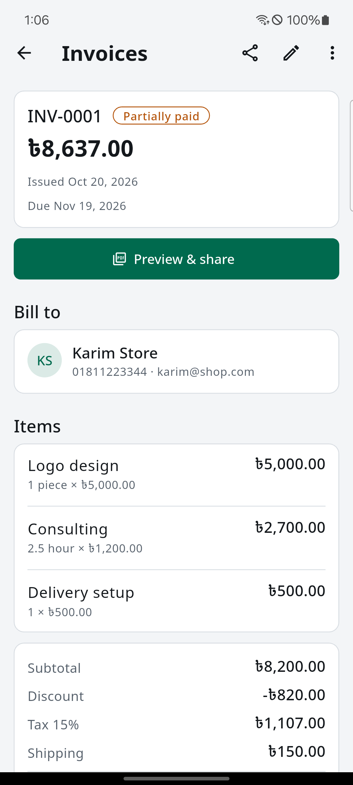
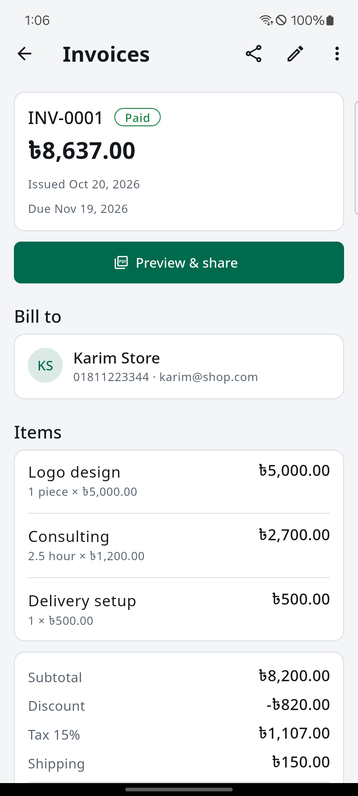
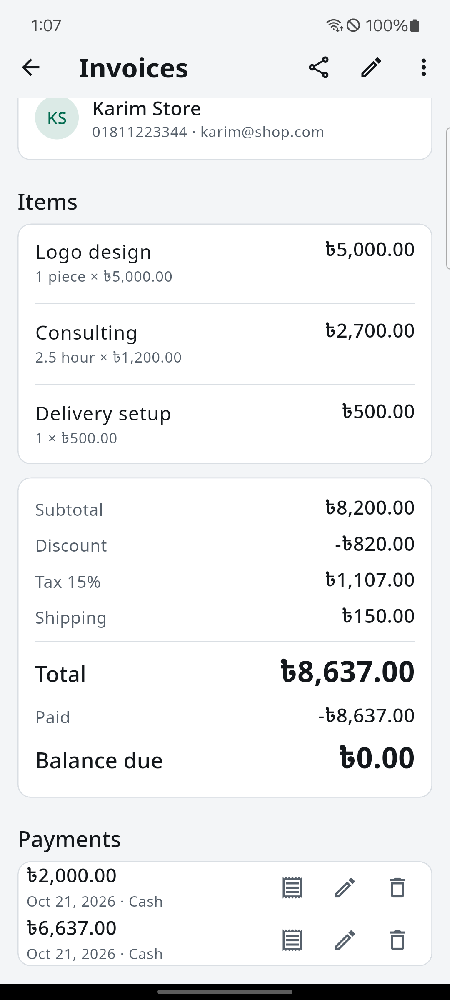
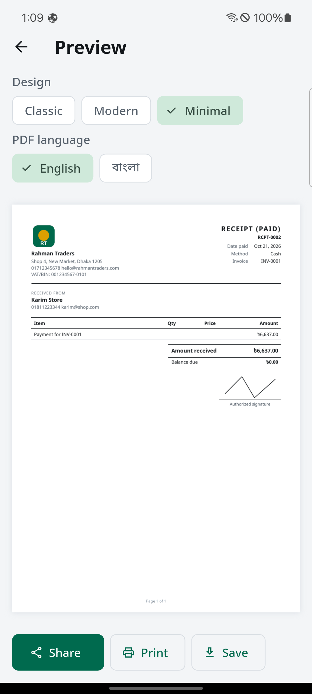
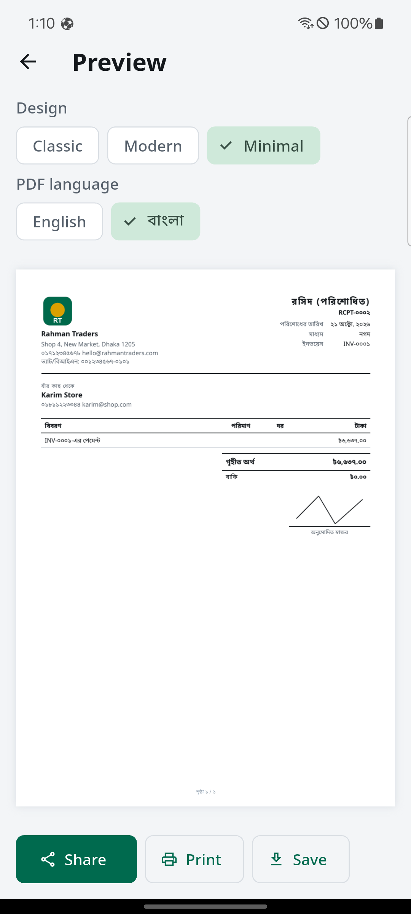
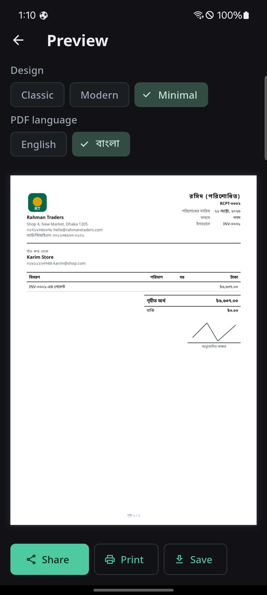
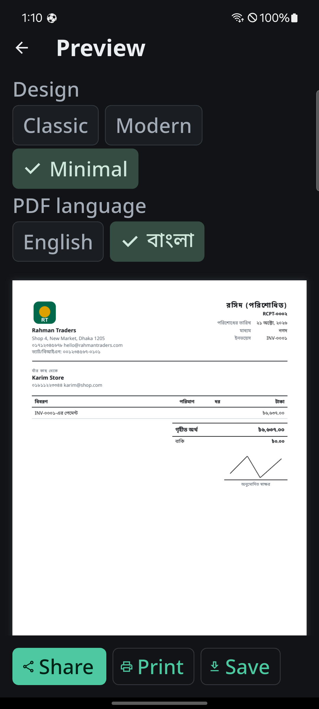
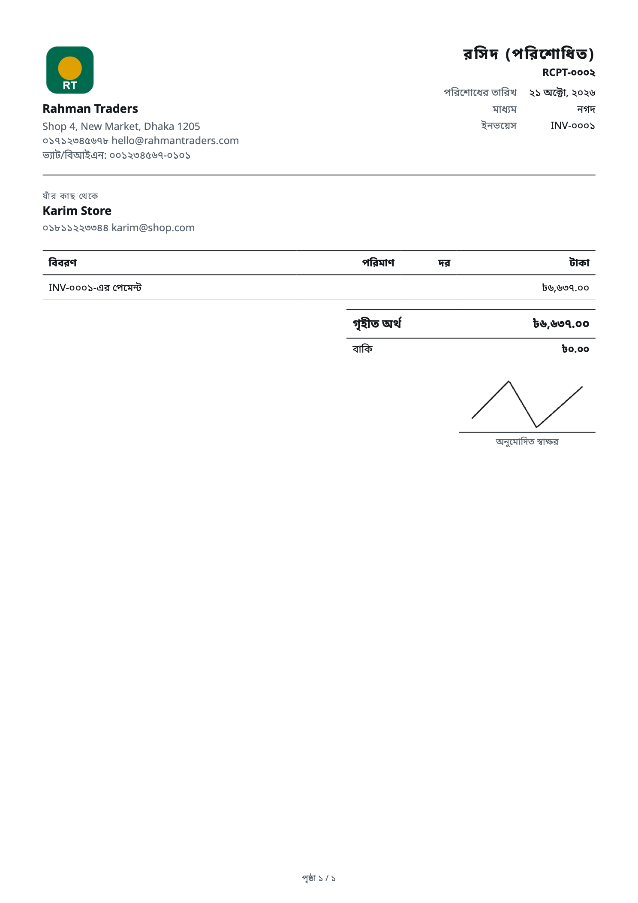
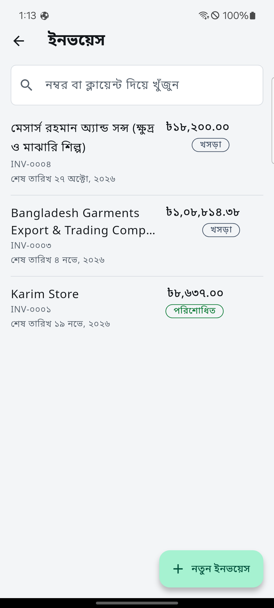
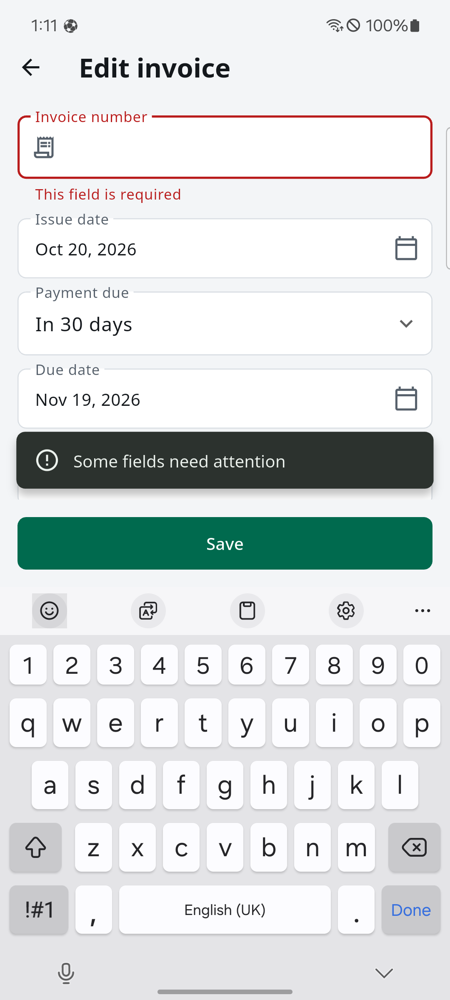

# M6 review — payments, receipts, statuses

Phone: Samsung A52 (SM-A525F, Android 14), 21 Oct 2026. Branch `m6-payments`.
Light and dark, English and Bangla, font scale 2.0, then restored to 1.1,
light mode, and English.

## What was checked

On INV-0001 (Karim Store, total ৳8,637, previously Sent):

1. Recorded ৳2,000 cash. Status became **Partially paid**. Paid showed
   −৳2,000 and the balance due was ৳6,637.
2. Recorded the rest. The sheet opened already filled with ৳6,637. Status
   became **Paid** and the balance due was ৳0.00. The invoice list in Bangla
   shows that invoice as পরিশোধিত with Bangla digits.
3. Opened the receipt for the second payment. It is **RCPT-0002**, template
   Minimal (the last design the app remembered), one row "Payment for
   INV-0001", amount received ৳6,637, balance due ৳0, stamp PAID.
4. Switched the PDF language to Bangla on the phone, then pulled
   `cache/pdf/RCPT-0002.pdf` and rendered it on the Mac. Title রসিদ
   (পরিশোধিত), method নগদ, amount ৳৬,৬৩৭.০০, date ২১ অক্টোবর, ২০২৬.
   Conjuncts in পরিশোধিত and গৃহীত hold together. Bangla digits are used for
   the money, the date, and the phone numbers. The business name and address
   stay in the Latin script they were typed in.

The share sheet was not opened. It lists the owner's contacts, so it is not
in this review. Share, Print, and Save are on the preview screen.

## Screenshots

Partial payment, light, English:

Paid in full:

Both payments on the invoice:

Receipt, English, light:

Receipt, Bangla, light, on the phone:

Same receipt, dark:

Dark, font scale 2.0. The design chips wrap onto a second line. Share, Print,
and Save stay on one row. Nothing overflows the screen.

Bangla receipt rendered on the Mac from the pulled PDF:

Invoice list in Bangla. INV-0001 is পরিশোধিত. The long Bangla client name
(ক্ষুদ্র) is intact.

## Fix checked on the phone

Clearing the invoice number and tapping Save while the keyboard was still
open used to leave "This field is required" under the Save bar. The line now
sits above Save, and the summary "Some fields need attention" sits just above
the button. The edit was discarded, so INV-0001 kept its number.

## Decisions kept

- Methods: cash, bKash, Nagad, Rocket, bank transfer, card, other. The form
  starts on cash. In Bangla, cash is নগদ and the Nagad wallet is নগদ (মোবাইল).
- A payment cannot be larger than the balance. On edit, the cap includes that
  payment's current amount.
- Recording a payment does not change Draft or Sent. Overdue still wins over
  Partially paid when the due day has passed and money is owed.
- Receipt numbers are RCPT-0001 style, assigned on save, never reused.
- The receipt uses the same three templates as the invoice. Language starts
  as the app language.

## Not done

- The PDF bridge is still untested on Android 7 (API 24) and on a phone newer
  than the A52.
- The home screen is still the temporary one, including the outdated
  "PDF and sharing come next" card. That is M7.
- Share, print, and the system save dialog were not driven, on purpose for
  the share sheet.
